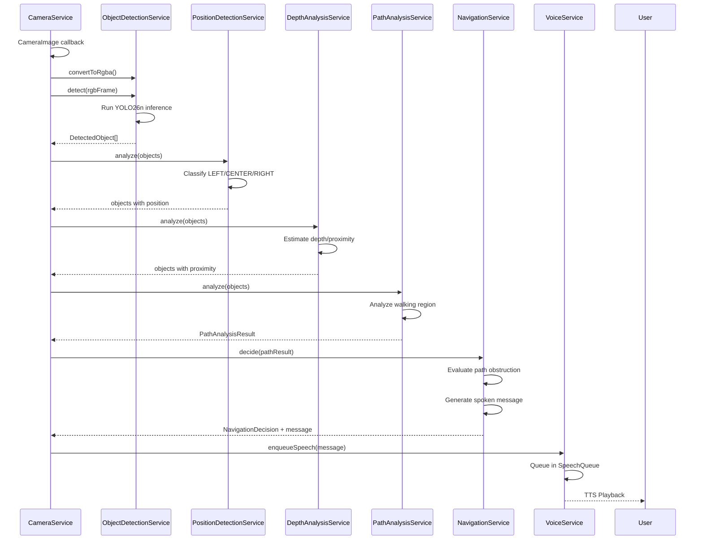
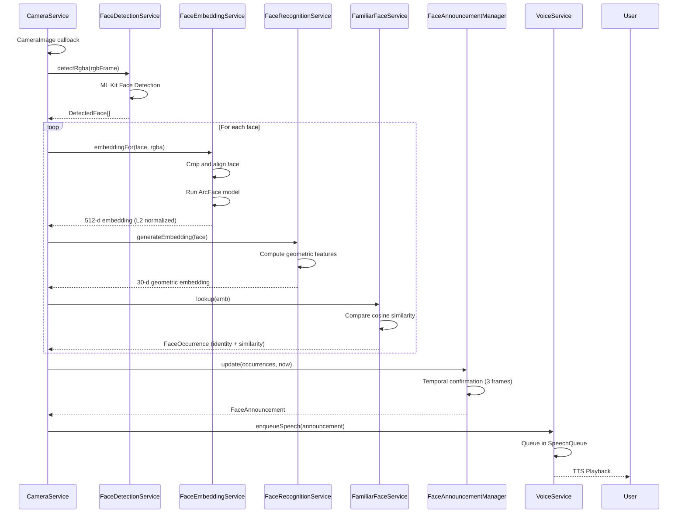

# VisionPath AI - System Architecture and Diagrams

## 1. High-Level Architecture

```
┌─────────────────────────────────────────────────────────────────────────────┐
│                            VisionPath AI Architecture                        │
│                              (Layered Pattern)                               │
├─────────────────────────────────────────────────────────────────────────────┤
│                                                                              │
│  ┌──────────────────────────────────────────────────────────────────────┐   │
│  │                          PRESENTATION LAYER                           │   │
│  │  ┌──────────────┐  ┌──────────────┐  ┌──────────────┐  ┌───────────┐ │   │
│  │  │ Navigate     │  │ Familiar     │  │ Read Text    │  │ Settings  │ │   │
│  │  │ Screen       │  │ Faces Screen │  │ Screen       │  │ Screens   │ │   │
│  │  └──────────────┘  └──────────────┘  └──────────────┘  └───────────┘ │   │
│  │  ┌──────────────┐  ┌──────────────┐  ┌──────────────┐  ┌───────────┐ │   │
│  │  │ Currency     │  │ Emergency    │  │ Voice        │  │ Widgets   │ │   │
│  │  │ Recognition  │  │ Screen       │  │ Assistant    │  │           │ │   │
│  │  │ Screen       │  │              │  │                │  │           │ │   │
│  │  └──────────────┘  └──────────────┘  └──────────────┘  └───────────┘ │   │
│  └──────────────────────────────────────────────────────────────────────┘   │
│                                                                              │
│  ┌──────────────────────────────────────────────────────────────────────┐   │
│  │                       BUSINESS LOGIC LAYER                             │   │
│  │  ┌──────────────┐  ┌──────────────┐  ┌──────────────┐  ┌───────────┐ │   │
│  │  │ Navigation   │  │ Face         │  │ OCR          │  │ Currency  │ │   │
│  │  │ Service      │  │ Recognition  │  │ Service      │  │ Service   │ │   │
│  │  └──────────────┘  └──────────────┘  └──────────────┘  └───────────┘ │   │
│  │  ┌──────────────┐  ┌──────────────┐  ┌──────────────┐  ┌───────────┐ │   │
│  │  │ Depth        │  │ Path         │  │ Object       │  │ Voice     │ │   │
│  │  │ Analysis     │  │ Analysis     │  │ Detection    │  │ Service   │ │   │
│  │  └──────────────┘  └──────────────┘  └──────────────┘  └───────────┘ │   │
│  │  ┌──────────────┐  ┌──────────────┐  ┌──────────────┐  ┌───────────┐ │   │
│  │  │ SOS          │  │ Settings     │  │ Camera       │  │ Vibration │ │   │
│  │  │ Service      │  │ Service      │  │ Service      │  │ Service   │ │   │
│  │  └──────────────┘  └──────────────┘  └──────────────┘  └───────────┘ │   │
│  └──────────────────────────────────────────────────────────────────────┘   │
│                                                                              │
│  ┌──────────────────────────────────────────────────────────────────────┐   │
│  │                          DATA LAYER                                    │   │
│  │  ┌──────────────┐  ┌──────────────┐  ┌──────────────┐  ┌───────────┐ │   │
│  │  │ Settings     │  │ Familiar     │  │ Emergency    │  │ Speech    │ │   │
│  │  │ Storage      │  │ Face         │  │ Contacts     │  │ Queue     │ │   │
│  │  │ (SharedPreferences)│  │ Repository   │  │ Storage    │  │           │ │   │
│  │  └──────────────┘  └──────────────┘  └──────────────┘  └───────────┘ │   │
│  │  ┌──────────────┐  ┌──────────────┐  ┌──────────────┐                │   │
│  │  │ Face         │  │ OCR          │  │ Detection    │                │   │
│  │  │ Embeddings   │  │ Results      │  │ Coordinates  │                │   │
│  │  └──────────────┘  └──────────────┘  └──────────────┘                │   │
│  └──────────────────────────────────────────────────────────────────────┘   │
│                                                                              │
│  ┌──────────────────────────────────────────────────────────────────────┐   │
│  │                      ML/AI INFERENCE LAYER                             │   │
│  │  ┌──────────────┐  ┌──────────────┐  ┌──────────────┐  ┌───────────┐ │   │
│  │  │ YOLO         │  │ ArcFace      │  │ SCRFD        │  │ Mobile    │ │   │
│  │  │ Detection    │  │ Embedding    │  │ Face         │  │ FaceNet   │ │   │
│  │  └──────────────┘  └──────────────┘  │ Detector     │  │ Embedding │ │   │
│  │  ┌──────────────┐  └──────────────┘  └──────────────┘  └───────────┘ │   │
│  │  │ ML Kit OCR   │                                                      │   │
│  │  │ Text         │  ┌──────────────┐  ┌──────────────┐                │   │
│  │  │ Recognition  │  │ Vosk         │  │ Currency     │                │   │
│  │  └──────────────┘  │ Speech       │  │ Detector     │                │   │
│  │                      │ Recognition│  │ (YOLO)       │                │   │
│  │                      └────────────┘  └──────────────┘                │   │
│  └──────────────────────────────────────────────────────────────────────┘   │
│                                                                              │
│  ┌──────────────────────────────────────────────────────────────────────┐   │
│  │                         EXTERNAL DEVICES                               │   │
│  │  ┌──────────────┐  ┌──────────────┐  ┌──────────────┐  ┌───────────┐ │   │
│  │  │ Camera       │  │ Microphone   │  │ Speaker      │  │ Vibration │ │   │
│  │  │ (TensorFlow) │  │ (Vosk)       │  │ (TTS)        │  │ (Haptic)  │ │   │
│  │  └──────────────┘  └──────────────┘  └──────────────┘  └───────────┘ │   │
│  └──────────────────────────────────────────────────────────────────────┘   │
│                                                                              │
└─────────────────────────────────────────────────────────────────────────────┘
```

## 2. Component Architecture

```
┌─────────────────────────────────────────────────────────────────────────────┐
│                         Component Dependencies                              │
├─────────────────────────────────────────────────────────────────────────────┤
│                                                                              │
│  NavigateScreen                                                              │
│       │                                                                        │
│       ├─→ CameraService                                                      │
│       ├─→ ObjectDetectionService    ←─→ YOLO TFLite Model                  │
│       ├─→ PositionDetectionService                                           │
│       ├─→ DepthAnalysisService      ←─→ Depth Engine                        │
│       ├─→ PathAnalysisService                                                │
│       ├─→ NavigationService         ←─→ SceneAnnouncer                     │
│       ├─→ InstructionManager                                                 │
│       └─→ VoiceService              ←─→ SpeechQueue                        │
│                                                                              │
│  FamiliarFacesScreen                                                         │
│       │                                                                        │
│       ├─→ CameraService                                                      │
│       ├─→ FaceDetectionService      ←─→ ML Kit Face Detector               │
│       ├─→ ScrfdFaceDetector         ←─→ SCRFD TFLite Model                 │
│       ├─→ FaceEmbeddingService      ←─→ ArcFace TFLite Model               │
│       ├─→ FaceRecognitionService                                             │
│       ├─→ FamiliarFaceService       ←─→ FamiliarFaceRepository             │
│       ├─→ FaceAnnouncementManager                                            │
│       └─→ VoiceService              ←─→ SpeechQueue                        │
│                                                                              │
│  ReadTextScreen                                                              │
│       │                                                                        │
│       ├─→ CameraService                                                      │
│       ├─→ OcrService                ←─→ ML Kit OCR                         │
│       ├─→ TextGuidanceService                                                │
│       └─→ VoiceService              ←─→ SpeechQueue                        │
│                                                                              │
│  CurrencyRecognitionScreen                                                   │
│       │                                                                        │
│       ├─→ CameraService                                                      │
│       ├─→ CurrencyDetector          ←─→ Currency YOLO TFLite Model         │
│       ├─→ CurrencyRecognitionService                                         │
│       └─→ CurrencyStabilityVerifier                                          │
│                                                                              │
│  EmergencyScreen                                                             │
│       │                                                                        │
│       ├─→ SosService                ←─→ SosPlatform                         │
│       │     │                                                                  │
│       │     ├─→ EmergencyContactService  ←─→ SharedPreferences             │
│       │     ├─→ NavigationService                                            │
│       │     ├─→ VoiceService                                                 │
│       │     ├─→ VibrationService                                             │
│       │     └─→ SettingsService                                              │
│       └─→ VoiceService              ←─→ SpeechQueue                        │
│                                                                              │
└─────────────────────────────────────────────────────────────────────────────┘
```

## 3. Data Flow Diagrams

### 3.1 Object Detection Pipeline

```
┌─────────────────────────────────────────────────────────────────────────────┐
│                    Object Detection Pipeline                                │
├─────────────────────────────────────────────────────────────────────────────┤
│                                                                              │
│  CameraFrame (CameraImage)                                                   │
│       │                                                                        │
│       ▼                                                                        │
│  [CameraService]                                                             │
│       │  - Convert YUV to RGB                                                │
│       │  - Apply rotation                                                    │
│       │  - Normalize to [0,1]                                                │
│       ▼                                                                        │
│  RGBA Frame (Uint8List)                                                      │
│       │                                                                        │
│       ▼                                                                        │
│  [ObjectDetectionService]                                                    │
│       │  - Run YOLO26n inference                                             │
│       │  - Parse detection boxes                                             │
│       │  - Extract class, confidence, bounding box                           │
│       ▼                                                                        │
│  DetectedObject[]                                                            │
│       │                                                                        │
│       ▼                                                                        │
│  [PositionDetectionService]                                                  │
│       │  - Calculate center X                                                │
│       │  - Classify: LEFT/CENTER/RIGHT                                       │
│       ▼                                                                        │
│  DetectedObject[] (with position)                                            │
│       │                                                                        │
│       ▼                                                                        │
│  [DepthAnalysisService]                                                      │
│       │  - Estimate proximity (NEAR/MEDIUM/FAR)                              │
│       │  - Calculate relative depth                                          │
│       ▼                                                                        │
│  DetectedObject[] (with proximity)                                           │
│       │                                                                        │
│       ▼                                                                        │
│  [PathAnalysisService]                                                       │
│       │  - Analyze central walking region                                    │
│       │  - Identify primary blocker                                          │
│       │  - Calculate left/right margins                                      │
│       ▼                                                                        │
│  PathAnalysisResult                                                          │
│       │                                                                        │
│       ▼                                                                        │
│  [NavigationService]                                                         │
│       │  - Evaluate path obstruction                                         │
│       │  - Determine decision: FORWARD/LEFT/RIGHT/SLOW/STOP                  │
│       │  - Generate spoken message                                           │
│       ▼                                                                        │
│  NavigationDecision + SpokenMessage                                          │
│       │                                                                        │
│       ▼                                                                        │
│  [InstructionManager]                                                        │
│       │  - Check cooldown                                                    │
│       │  - Deduplicate redundant instructions                                │
│       ▼                                                                        │
│  Instruction (if cooldown elapsed)                                           │
│       │                                                                        │
│       ▼                                                                        │
│  [VoiceService]                                                              │
│       │  - Queue sentence in SpeechQueue                                     │
│       ▼                                                                        │
│  TTS Playback                                                                │
│                                                                              │
└─────────────────────────────────────────────────────────────────────────────┘
```

### 3.2 Face Recognition Pipeline

```
┌─────────────────────────────────────────────────────────────────────────────┐
│                     Face Recognition Pipeline                               │
├─────────────────────────────────────────────────────────────────────────────┤
│                                                                              │
│  CameraFrame (CameraImage)                                                   │
│       │                                                                        │
│       ▼                                                                        │
│  [FaceDetectionService]                                                      │
│       │  - ML Kit Face Detector                                              │
│       │  - Detect faces with landmarks (5 points)                            │
│       │  - Detect face contours                                              │
│       ▼                                                                        │
│  DetectedFace[] (with landmarks)                                             │
│       │                                                                        │
│       ▼                                                                        │
│  [FaceEmbeddingService]                                                      │
│       │  - Crop and align face using landmarks                               │
│       │  - Run ArcFace model (input: 112×112 RGB)                            │
│       │  - Extract 512-d embedding                                           │
│       │  - L2 normalize embedding                                            │
│       ▼                                                                        │
│  List<double> (512-d embedding)                                              │
│       │                                                                        │
│       ▼                                                                        │
│  [FamiliarFaceService]                                                       │
│       │  - Load registered faces from SharedPreferences                      │
│       │  - Compare cosine similarity                                         │
│       │  - Match above threshold (0.95)                                      │
│       ▼                                                                        │
│  FaceOccurrence[] (identity match or unknown)                                │
│       │                                                                        │
│       ▼                                                                        │
│  [FaceAnnouncementManager]                                                   │
│       │  - Track faces across frames                                         │
│       │  - Temporal confirmation (3 frames)                                  │
│       │  - Anti-flutter mechanism                                            │
│       ▼                                                                        │
│  AnnouncedFace (confirmed identity + position)                               │
│       │                                                                        │
│       ▼                                                                        │
│  [VoiceService]                                                              │
│       │  - Generate announcement: "John detected, 2.4 meters ahead"          │
│       ▼                                                                        │
│  TTS Playback                                                                │
│                                                                              │
└─────────────────────────────────────────────────────────────────────────────┘
```

### 3.3 Emergency SOS Flow

```
┌─────────────────────────────────────────────────────────────────────────────┐
│                        Emergency SOS Flow                                   │
├─────────────────────────────────────────────────────────────────────────────┤
│                                                                              │
│  User Press-and-Hold SOS Button                                              │
│       │                                                                        │
│       ▼                                                                        │
│  [SosHoldController]                                                         │
│       │  - Start countdown (5 seconds default)                               │
│       │  - Voice cues: "Release to cancel"                                   │
│       ▼                                                                        │
│  Countdown Complete?                                                         │
│       │                                                                        │
│       ├─ NO ── Release ──→ Cancel SOS                                        │
│       │                                                                        │
│       ▼ YES                                                                    │
│  [SosService]                                                                │
│       │  - Set state: ACTIVATING                                             │
│       │  - Play alert sound                                                  │
│       │  - Start vibration pattern                                           │
│       ▼                                                                        │
│  Step 1: Alert (immediate)                                                   │
│       │                                                                        │
│       ▼                                                                        │
│  Step 2: Location Fix (concurrent)                                           │
│       │  - Request location permissions                                      │
│       │  - Get GPS/network fix                                              │
│       │  - Format location URL                                              │
│       ▼                                                                        │
│  Step 3: Call Primary Contact (concurrent)                                   │
│       │  - Request CALL_PHONE permission                                     │
│       │  - Place call via telephony API                                      │
│       ▼                                                                        │
│  Step 4: SMS with Location (concurrent)                                      │
│       │  - Request SEND_SMS permission                                       │
│       │  - Send SMS with location URL                                        │
│       ▼                                                                        │
│  Step 5: Notification                                                        │
│       │  - Post ongoing notification                                         │
│       │  - Show emergency status                                             │
│       ▼                                                                        │
│  SosState.ACTIVE                                                             │
│       │                                                                        │
│  (Continues until reset by user)                                             │
│                                                                              │
└─────────────────────────────────────────────────────────────────────────────┘
```

## 4. State Management Architecture

### 4.1 Provider Tree

```dart
VisionPathApp
├── MultiProvider
│   ├── ChangeNotifierProvider<CameraService>
│   ├── ChangeNotifierProvider<ObjectDetectionService>
│   ├── Provider<PositionDetectionService>
│   ├── Provider<DepthAnalysisService>
│   ├── Provider<PathAnalysisService>
│   ├── ChangeNotifierProvider<NavigationService>
│   ├── ChangeNotifierProvider<FamiliarFaceService>
│   ├── ChangeNotifierProvider<SettingsService>
│   └── ChangeNotifierProvider<SosService>
└── _AppRoot
    └── Navigator
```

### 4.2 State Classes

| Service | State Type | Purpose |
|---------|-----------|---------|
| CameraService | ChangeNotifier | Camera lifecycle state |
| ObjectDetectionService | ChangeNotifier | Detection results |
| NavigationService | ChangeNotifier | Navigation decisions |
| FamiliarFaceService | ChangeNotifier | Registered faces |
| SettingsService | ChangeNotifier | Settings persistence |
| SosService | ChangeNotifier | Emergency state |
| VoiceService | Static | Speech queue management |

## 5. Threading Model

### 5.1 Main Thread (Dart)

| Component | Purpose |
|-----------|---------|
| UI Rendering | Widget tree updates |
| Event Handlers | Button presses, gestures |
| Provider Updates | State change propagation |

### 5.2 Isolate-Heavy Operations

| Operation | Thread | Reason |
|-----------|--------|--------|
| Camera Frame Processing | Main + Platform | CameraImage callback |
| TFLite Inference | Main | Synchronous API |
| SharedPreferences I/O | Main | Async but fast |
| TTS Playback | Platform | Android TextToSpeech |

### 5.3 Concurrency Strategy

- **No isolates**: All inference runs on main thread
- **Camera callbacks**: Handle in main thread
- **File I/O**: Use async SharedPreferences
- **Platform channels**: Native threads, callback to Dart

## 6. Memory Management

### 6.1 Key Memory Consumers

| Component | Memory Usage | Management |
|-----------|-------------|------------|
| TFLite Models | 10-20 MB each | Lazy loaded, closed on dispose |
| Camera Preview | 1-5 MB/frame | Frame sampling (5 FPS) |
| Face Embeddings | 512 doubles/frame | Collected by GC |
| SharedPreferences | ~100 KB | In-memory cache |

### 6.2 Disposal Pattern

```dart
void dispose() {
  _camera?.dispose();
  _interpreter?.close();
  _recognizer?.close();
  super.dispose();
}
```

## 7. Platform Architecture

```
┌─────────────────────────────────────────────────────────────────────────────┐
│                         Platform Integration                                │
├─────────────────────────────────────────────────────────────────────────────┤
│                                                                              │
│  Flutter Application                                                         │
│       │                                                                        │
│       ├─ Platform Channel: Camera                                           │
│       ├─ Platform Channel: ML Kit                                           │
│       ├─ Platform Channel: TTS                                              │
│       ├─ Platform Channel: Permissions                                      │
│       ├─ Platform Channel: SOS (Phone/SMS/Location)                        │
│       └─ Platform Channel: Vibration                                        │
│                                                                              │
│  Android Framework                                                          │
│       │                                                                        │
│       ├─ CameraX / Camera2                                                  │
│       ├─ ML Kit Face Detection                                              │
│       ├─ TextToSpeech API                                                   │
│       ├─ Permission Manager                                                 │
│       ├─ Telephony Manager (Phone/SMS)                                      │
│       └─ Location Manager (GPS/Network)                                     │
│                                                                              │
└─────────────────────────────────────────────────────────────────────────────┘
```

## 8. Class Diagram (Key Classes)

```mermaid
classDiagram
    class NavigateScreen {
        +CameraService cameraService
        +ObjectDetectionService objectDetectionService
        +NavigationService navigationService
        +_NavState navState
        +void startNavigation()
        +void stopNavigation()
    }

    class CameraService {
        +CameraController? camera
        +Future~void~ initializeCamera()
        +Future~void~ switchCamera()
    }

    class ObjectDetectionService {
        +YOLO? yolo
        +List~DetectedObject~ currentResults
        +Future~bool~ initialize()
        +Future~List~DetectedObject~~ detect()
    }

    class NavigationService {
        +NavigationDecision lastDecision
        +String lastSpokenMessage
        +void decide(PathAnalysisResult path)
    }

    class FamiliarFaceService {
        +List~FamiliarFace~ people
        +Future~void~ load()
        +Future~FamiliarFace~ addPerson()
        +Future~bool~ deletePerson()
    }

    class FaceEmbeddingService {
        +Interpreter? interpreter
        +Future~List~double~~ embeddingFor()
    }

    class SettingsService {
        +bool voiceGuidanceEnabled
        +double voiceVolume
        +SpeechRate speechRate
        +Future~void~ load()
        +void setVoiceGuidanceEnabled()
    }

    class SosService {
        +SosSession session
        +static SosService instance
        +void activate()
        +void reset()
    }

    class VoiceService {
        +static SpeechQueue _speechQueue
        +static void enqueueSpeech()
        +static void speakEmergency()
    }

    class DetectedObject {
        +String className
        +double confidence
        +Rect boundingBox
        +ObjectPosition position
        +ProximityLevel? proximity
    }

    class FamiliarFace {
        +String id
        +String name
        +List~double~ embedding
        +int createdAt
    }

    class NavigationDecision {
        <<enumeration>>
        forward
        left
        right
        slow
        stop
    }

    class PathAnalysis {
        <<enumeration>>
        clear
        obstacleLeft
        obstacleCenter
        obstacleRight
    }

    class ProximityLevel {
        <<enumeration>>
        veryNear
        near
        medium
        far
    }
```



## 9. Sequence Diagram: Navigation Frame Processing



## 10. Sequence Diagram: Face Recognition Frame Processing


